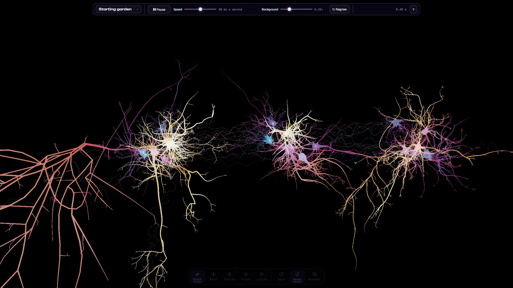

# Dendrite Garden

A neuron sandbox: neurons grown from real reconstructions, with ion channels and synapses taken from published recordings, simulated live in the browser on the graphics card. Build groups of them, wire them, and change anything while they run.

**The site: https://gsnautilus.github.io/dendrite-garden/**

- [**The garden**](https://gsnautilus.github.io/dendrite-garden/cortex.html): the page itself. It opens on a small garden of three groups, running.
- [**The manual**](https://gsnautilus.github.io/dendrite-garden/manual.html): how to use the page, step by step, with pictures. Its [list of sources](https://gsnautilus.github.io/dendrite-garden/manual.html#sources) gives the published work the garden's numbers, forms and data rest on.
- [**The guide for agents**](agents.md): every call of the page's API, `window.garden`, for an AI agent or a script building gardens through it.

## What it simulates

Each neuron has a body, the start of an axon where its spikes begin, and its own tree of dendrites grown from a group of mouse neuron reconstructions (the Allen Cell Types Database). Its membrane carries channel types from their papers (sodium, potassium, the M-current, calcium and calcium-activated potassium), held in a library that can be edited in the page. Its synapses are conductances with the short-term dynamics measured between real cells. Groups sit in regions of tissue with layers, and the garden menu builds a patch of mouse visual cortex of 1,827 neurons.

## What a browser needs

WebGPU. As of November 2026 the garden has run in Microsoft Edge 157 and Firefox 148 on Windows 11 with an NVIDIA GeForce RTX 3060; other browsers and graphics cards have not been tried. Where a browser has no WebGPU, or a graphics card cannot give the page what it needs, the page says so.

## The older gardens

The site as it stood in October 2026 (Cortex Garden with simpler neurons, the Tadpole guide, Cochlea Garden and the original Dendrite Garden) is kept as it was in [`2026-10/`](https://gsnautilus.github.io/dendrite-garden/2026-10/).
